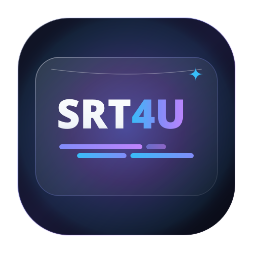
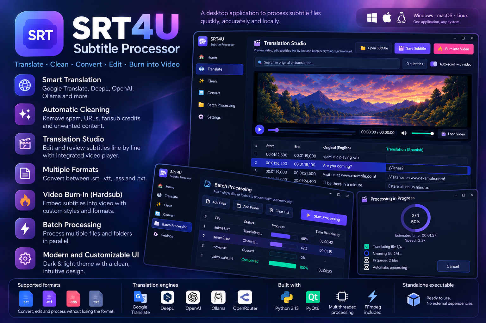

<div align="center">
  
</div>

# SRT4U - Subtitle Processor

[](LICENSE)
[](https://python.org)
[](https://pypi.org/project/PyQt6/)
[]()

[**English**](README.md) | [**Español**](README_es.md) | [**Deutsch**](README_de.md) | [**Français**](README_fr.md) | [**Italiano**](README_it.md) | **中文**

桌面应用，用于翻译、编辑、清理与转换字幕文件（`.srt`、`.vtt`、`.ass`/`.ssa`、`.txt`），带实时同步视频播放器与直接视频烧录导出。

当前稳定版：**[v1.4.11](https://github.com/marodriguezd/SRT4U-Subtitle-Processor/releases/tag/v1.4.11)**。详情见 [RELEASE_NOTES.md](RELEASE_NOTES.md)。



---

## 功能

- **多语言界面（i18n）**：
  - 启动时经 `QLocale` 自动检测系统语言。
  - 运行时实时切换语言，无需重启应用。
  - 支持 7 种语言：英语（`en`）、西班牙语（`es`）、葡萄牙语（`pt`）、德语（`de`）、意大利语（`it`）、法语（`fr`）与简体中文（`zh-CN`）。
  - 双入口：顶栏快速切换器与设置页持久化选择。
- **视频烧录（硬字幕导出）**：
  - 将字幕永久嵌入视频文件（`.mp4`、`.mkv`、`.webm` 等）。
  - 可视化定制：字号、颜色（白、黄、青）与阅读框（半透明、实心或描边）。
  - 自适应分辨率渲染：字幕按视频高度等比缩放（从 480p 到 4K 及竖屏 Reels/TikTok）。
  - 自动重叠清理：防止重叠的字幕时间码在屏幕上碰撞。
  - 实时进度弹窗，含编码速度（x）、已用时间与 ETA。
- **交互式翻译工作室**：
  - 实时并排卡片编辑器，逐行审校与优化翻译。
  - 与内置视频播放器同步（点击任意字幕跳转到对应视频帧）。
  - 即时搜索过滤 cue。
- **翻译引擎**：
  - Google Translate：内置免费层，零配置、无需 API key。
  - DeepL：支持 Free 与 Pro API key。
  - OpenAI / 本地 LLM：兼容 OpenAI、Ollama 与 OpenRouter 端点。
- **自动清理**：去除 Telegram 频道（`t.me`）、URL、字幕组成员名单、广告与音乐标记（`♪`），同时保留有效对白与格式标签（`<i>`、`<b>`、ASS 样式）。
- **格式转换**：`.srt`、`.vtt`、`.ass` 与纯文本 `.txt` 之间双向转换。
- **批量处理**：多文件队列，按文件跟踪进度。
- **字幕分析与确定性 QA**：分组的内容/时间/质量指标加基于规则的校验（`analyze`/`qa`，JSON/CSV）。
- **翻译基准**：可复现的多提供方对比，JSON/CSV 报告与离线分析 notebook。
- **本地 SQLite 历史**：每次执行记录聚合指标（历史页、`history` CLI）；不存文本、密钥或媒体。
- **本地 REST API**（可选 `[api]` extra）：`/api/v1`，含分析、QA、翻译/处理/转写/pipeline 任务、历史、基准、OpenAPI 文档——默认绑定 localhost，无鉴权。
- **本地 Whisper 转写**（可选 `[transcription]` extra）：音频/视频 → 字幕， feeding 分析、QA、清理、翻译、烧录。模型不捆绑；首次使用时下载。
- **端到端媒体流水线**：`srt4u pipeline` / Pipeline 页 / `POST /api/v1/pipeline` 串联转写 → 清理 → 分析 → QA → 可选翻译 → 终检 QA → 导出 → 可选烧录，按阶段报错并协作式（尽力）取消：排队任务丢弃，运行中任务完成后丢弃其结果。
- **Headless CLI**：不启动 PyQt6 即可批量处理、分析字幕指标、运行确定性 QA 并导出 JSON/CSV。
- **并行执行**：多线程分块翻译，加速大字幕文件。
- **深色 / 浅色 Glass 主题**：现代 Glassmorphism UI，主题即时切换。

---

## 安装与运行

### 要求
- Python 3.10 或更高
- `pip`

### 从源码运行

```bash
# 克隆仓库
git clone https://github.com/marodriguezd/SRT4U-Subtitle-Processor.git
cd SRT4U-Subtitle-Processor

# 创建并激活虚拟环境
python -m venv .venv
source .venv/bin/activate  # Windows: .venv\Scripts\activate

# 安装依赖（源码 checkout 路径：与 `pip install .` 同一基础栈）
pip install -r requirements.txt

# 运行桌面应用
python main.py

# 不打开 UI 直接处理
python -m application.cli process input.srt --output output.srt --clean
```

### 可选 extra

```bash
pip install ".[api]"            # 本地 REST API：srt4u serve（/api/v1，OpenAPI；默认 localhost，无 auth）
pip install ".[transcription]"  # 本地 Whisper：srt4u transcribe / pipeline media
pip install ".[dev]"            # pytest + ruff，供贡献者
```

> [!NOTE]
> 基础安装（`pip install .`）包含 GUI 与 CLI 栈（PyQt6 +
> `deep-translator`）以及分析、QA、翻译、历史与字幕输入 pipeline。
> `requirements.txt` 为源码 checkout 与 CI 镜像这些基础要求。`[api]`、`[transcription]` 与
> `[dev]` extra 增加 FastAPI、`faster-whisper` 与开发工具。Whisper
> 模型不捆绑；首次使用时提前告知后下载（`SRT4U_WHISPER_MODEL_DIR` 可迁移缓存）。
> 烧录需要 FFmpeg；CI 构建捆绑 FFmpeg 可执行文件，源码安装需要在 `PATH` 或应用包中有
> 可用的 FFmpeg。

### 60 秒快速上手

```bash
python -m application.cli analyze input.srt --json
python -m application.cli qa input.srt --strict
python -m application.cli process input.srt --clean --translate --target en
python -m application.cli transcribe clip.mp4 --model small --language auto
python -m application.cli pipeline clip.mp4 --translate --target en -o out.srt --stats-json
python -m application.cli serve  # 文档见 http://127.0.0.1:8000/docs
```

架构（GUI/CLI/API → services → providers/SQLite/FFmpeg）与各领域指南：
[docs/cli.md](docs/cli.md)、[docs/api.md](docs/api.md)、
[docs/transcription.md](docs/transcription.md)、[docs/pipeline.md](docs/pipeline.md)、
[docs/database.md](docs/database.md)、[docs/tech-debt.md](docs/tech-debt.md)。

### 预编译二进制

当前稳定版为 **[v1.4.11](https://github.com/marodriguezd/SRT4U-Subtitle-Processor/releases/tag/v1.4.11)**（非预发布）。GitHub Actions 为每个稳定 `v*` 标签构建并附加以下资产：

| 资产 | 平台 | 架构 |
|---|---|---|
| [`SRT4U-Windows-x64.exe`](https://github.com/marodriguezd/SRT4U-Subtitle-Processor/releases/download/v1.4.11/SRT4U-Windows-x64.exe) | Windows 10/11 | x86_64 |
| [`SRT4U-Linux-x86_64.AppImage`](https://github.com/marodriguezd/SRT4U-Subtitle-Processor/releases/download/v1.4.11/SRT4U-Linux-x86_64.AppImage) | Linux | x86_64 |
| [`SRT4U-Linux-x86_64.tar.gz`](https://github.com/marodriguezd/SRT4U-Subtitle-Processor/releases/download/v1.4.11/SRT4U-Linux-x86_64.tar.gz) | Linux | x86_64 |
| [`SRT4U-macOS.dmg`](https://github.com/marodriguezd/SRT4U-Subtitle-Processor/releases/download/v1.4.11/SRT4U-macOS.dmg) | macOS（Apple Silicon） | **仅 arm64**——无法在 Intel Mac 启动 |
| [`checksums.txt`](https://github.com/marodriguezd/SRT4U-Subtitle-Processor/releases/download/v1.4.11/checksums.txt) | 上述资产的 SHA-256 校验和 | — |

CI 构建捆绑版本锁定的静态 FFmpeg 可执行文件，开箱即用支持烧录；平台运行时库要求仍然适用。
源码安装（上一节）需要在 `PATH` 有可用的 FFmpeg 方可烧录。

---

## Headless CLI

CLI 复用 `SubtitleService`，无需创建 Qt 应用即可清理、翻译、转换格式与批量处理目录。
安装包后运行 `srt4u process`；checkout 下用 `python -m application.cli process`。
支持 JSON 预设与 `--translate --source auto --target es --engine ollama` 等选项。
示例、预设键与输出行为见 [docs/cli.md](docs/cli.md)。

## 分析与 QA

`analyze` 计算分组的内容、时间、质量与处理指标。`qa` 按可配置阈值报告确定性字幕问题。
两命令均支持 JSON；分析还可导出 CSV。指标定义、规则默认值与 CLI 导出示例见
[docs/analytics.md](docs/analytics.md)。

## 翻译提供方与指标

`TranslationService` 经 `ProviderRegistry` 分发到 `Google`、`DeepL` 或 OpenAI 兼容端点
（`openai`、`llm`、`ollama` 别名共享实现；请求的提供方保留于指标）。
错误归一化（`error_type`），重试 opt-in，回退显式、可配置、无环。
`translate_with_metrics()` 返回带 JSON 可序列化 `TranslationMetrics` 的 `TranslationResult`；
CLI 以 `--stats` 或 `--stats-json` 打印，`estimated_cost` 保持 `null`——不虚构资费。

`benchmark` 对版本化数据集跑多提供方 N 轮，导出 JSON/CSV 供离线分析
（`notebooks/benchmark_analysis.ipynb` + `analysis/benchmark_analysis.py`）。
执行记录于本地 SQLite 历史（`history` CLI、历史页、基准用 `--store`）：仅聚合指标——
从不存储文本、密钥或媒体。

深入阅读：[docs/providers.md](docs/providers.md)、[docs/benchmarking.md](docs/benchmarking.md)、
[docs/benchmark_analysis.md](docs/benchmark_analysis.md)、[docs/database.md](docs/database.md)、
[docs/api.md](docs/api.md)、[docs/transcription.md](docs/transcription.md) 与
[docs/pipeline.md](docs/pipeline.md)。

## 运行测试

测试套件覆盖解析、清理、跨格式转换、免费翻译、UI 流程、UI 布局回归
（6 语言 × 2 主题的截断文本检测）与对话框几何不变式：

```bash
pytest tests/ -m "not network"  # 无需网络、密钥或 Whisper 模型
pytest tests/ -m "not network" --cov=application --cov-report=term-missing  # 同套件带覆盖率（下限 62%，见 [tool.coverage.report]）
```

---

## 开发者工具

### 截图画廊生成器

`tools/regenerate_screenshots.py` 重新生成 UI 评审用的离屏可视验证画廊：
主窗口页面（Home、Settings、About）× 语言 × 深/浅主题，外加烧录对话框、
进度弹窗、主题化文件对话框（深/浅）与每语言消息框。

```bash
QT_QPA_PLATFORM=offscreen python tools/regenerate_screenshots.py [--out DIR] [--langs en,es,...]
```

- 输出默认到 `/tmp/srt4u-shots`（6 UI 语言共 46 PNG）；目标目录旧 PNG 被覆盖。
- 无显示器时使用 Qt offscreen 平台，且 FFmpeg 烧录 worker 已被禁用，可 headless 安全运行。
- 打印每对话框的结果尺寸与声明最小尺寸作快速几何 sanity 检查（期望 `size == min`）。
- 该工具由 `tests/test_screenshot_tool.py` 烟雾测试防 bit-rot，每个 CI 测试任务都在子进程中运行它。

---

## 日志与排障

失败写入轮转日志文件（512 KB × 3）而非被吞掉：

| 平台 | 位置 |
|---|---|
| Windows | `%APPDATA%\SRT4U\srt4u.log` |
| macOS | `~/Library/Application Support/SRT4U/srt4u.log` |
| Linux | `~/.config/SRT4U/srt4u.log`（或 `$XDG_CONFIG_HOME/SRT4U/srt4u.log`） |

记录配置读写失败、按块翻译引擎错误、FFmpeg 检测/时长/尺寸问题、意外异常
（含 traceback）与最终退出码。Qt 自身消息也路由至此
（`qWarning`/`qCritical`/`qFatal`，debug 级还有 `qDebug`/`qInfo`），因此多媒体/codec
告警与平台插件诊断与应用自身条目并列。当失败用户可见——设置未保存、翻译不完整、
设置文件不可读、未处理错误——应用显示指向该文件的对话框。

---

## 支持的格式

| 格式 | 扩展名 | 读 | 写 | 样式保留 |
|---|---|:---:|:---:|:---:|
| SubRip Subtitle | `.srt` | 是 | 是 | 是（HTML 标签） |
| Web Video Text Tracks | `.vtt` | 是 | 是 | 是（cue settings 与标签） |
| Advanced SubStation Alpha | `.ass` / `.ssa` | 是 | 是 | 是（样式与位置） |
| 纯文本对白 | `.txt` | 是 | 是 | 仅行 |
